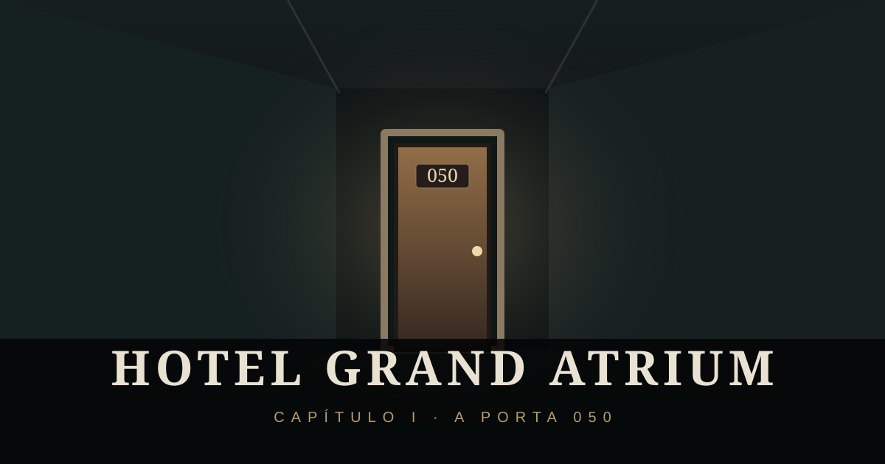

# 🏨 Hotel Grand Atrium

**Capítulo I — A Porta 050** · Terror em primeira pessoa com gráficos retrô e suporte para computador e celular.



## 🎮 Jogar online

**[Abrir o jogo](https://v-prof1.github.io/Hotel-Grand-Atrium/)**

O jogo estará disponível nesse endereço assim que **GitHub Pages** for habilitado em *Settings → Pages → Deploy from a branch → main → / (root)*.

O arquivo `index.html` também pode ser aberto diretamente em um navegador.

## Sobre o jogo

Explore um hotel assombrado com elevador inicial e recepção, tutorial opcional, 50 portas, salas diferentes, ameaças com sinais próprios, esconderijos, chaves, armadilhas, segunda chance com três desafios e final cinematográfico com a mensagem **CONTINUA**.

### Controles para PC

| Tecla | Ação |
| --- | --- |
| WASD | Andar |
| Mouse / setas | Olhar |
| E | Interagir |
| Shift | Correr |
| C | Agachar |
| V | Ouvir portas |
| F | Lanterna |
| Q | Curativo |
| Esc | Pausar |

No celular, use o joystick e os botões na tela.

## 📁 Estrutura

```text
Hotel-Grand-Atrium/
├── index.html          # Jogo completo
├── assets/
│   └── preview.svg     # Arte do projeto
├── README.md
├── CHANGELOG.md
├── .gitignore
└── .nojekyll
```

## 💡 GitHub Pages

1. No repositório, vá até **Settings > Pages**.
2. Em **Build and deployment**, escolha **Deploy from a branch**.
3. Em **Branch**, selecione **main** e **/(root)**.
4. Clique em **Save** e use o endereço mostrado pelo GitHub.

Não é necessário servidor ou processo de compilação. Alguns efeitos de áudio externos opcionais podem precisar de conexão; o jogo possui efeitos locais alternativos.

## Desenvolvimento

Projeto independente inspirado no gênero de terror de portas e exploração. As criaturas, a história e o nome do jogo são próprios.
